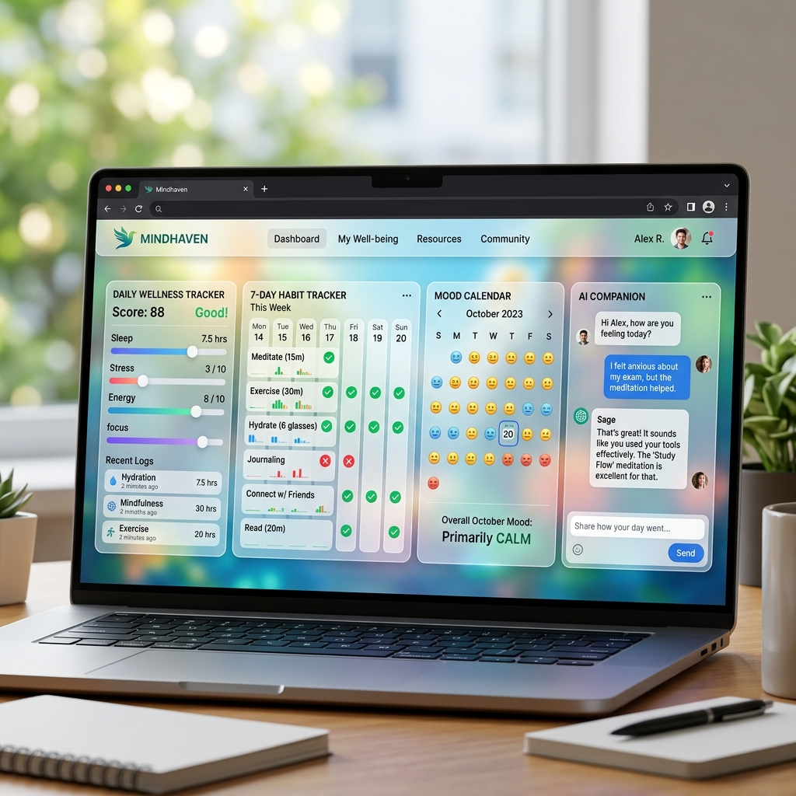

# MindCare 🧠💙

**MindCare** is a student-focused, comprehensive mental wellness and psychoeducation platform. Designed with a premium, glassmorphic UI, it empowers students to monitor, understand, and improve their mental well-being through science-backed screening tools, personalized insights, habit tracking, community support, and real-time AI-powered conversations.



---

## 🚀 Vision & Key Highlights

- **Vibrant & Modern UI**: Built with dynamic light/dark mode themes utilizing Tailwind CSS, Framer Motion, and premium glassmorphism aesthetics.
- **Science-Backed Self-Assessments**: Standardized clinical questionnaires (PHQ-9 & GAD-7) with immediate risk scoring and longitudinal progress tracking.
- **AI-Powered Companionship**: Real-time, evidence-based coping suggestions from a supportive AI chatbot running on Supabase Edge Functions via Google's Gemini 2.5 Flash.
- **Privacy & Safety First**: Granular PostgreSQL Row-Level Security (RLS) policies per table, server-side secret management in Supabase Edge Functions (Gemini API key is never exposed to the client), private journaling, and an anonymous student community feed with active content moderation edge functions.

---

## ✨ Comprehensive Feature Suite (6 Core Working Modules)

### 1. 📋 Mental Wellness Screening Module
- **Primary Source File**: [`src/pages/Assessments.tsx`](file:///d:/ANTI%20GRAVITY/Mind%20care/src/pages/Assessments.tsx) | [`src/components/assessments/AssessmentForm.tsx`](file:///d:/ANTI%20GRAVITY/Mind%20care/src/components/assessments/AssessmentForm.tsx)
- **Standardized Questionnaires**: Combined PHQ-9 (9 items, Depression screening) & GAD-7 (7 items, Anxiety screening) with intuitive 0–3 frequency selectors.
- **Deterministic Severity Banding**: Instant client-side scoring mapping raw points to validated severity tiers (`minimal`, `mild`, `moderate`, `moderately_severe`, `severe`) defined in [`src/data/assessmentQuestions.ts`](file:///d:/ANTI%20GRAVITY/Mind%20care/src/data/assessmentQuestions.ts).
- **Suicidal Ideation Circuit-Breaker**: Immediate high-risk routing and helpline presentation if PHQ-9 item 9 is scored > 0, regardless of composite score.
- **Edge Function Evaluation**: Dedicated Supabase Edge Function ([`supabase/functions/evaluate-assessment/index.ts`](file:///d:/ANTI%20GRAVITY/Mind%20care/supabase/functions/evaluate-assessment/index.ts)) securely evaluates nuanced emotional context with Gemini 2.5 Flash and persists records under authenticated user RLS.

### 2. 🤖 3-Tier AI Chatbot Companion
- **Primary Source File**: [`src/pages/Chat.tsx`](file:///d:/ANTI%20GRAVITY/Mind%20care/src/pages/Chat.tsx) | [`supabase/functions/chatbot/index.ts`](file:///d:/ANTI%20GRAVITY/Mind%20care/supabase/functions/chatbot/index.ts)
- **Tier 1 (Safety Guardrail)**: Deterministic regex/keyword scanner against acute crisis indicators (`suicide`, `self-harm`, etc.). Bypasses LLM immediately to present verified emergency hotlines (iCall, Vandrevala Foundation, NIMHANS).
- **Tier 2 (FAQ Knowledge Match)**: Instant PostgreSQL lookup against `chatbot_faqs` table for active student psychoeducation answers at zero latency and zero token cost.
- **Tier 3 (Generative AI Reasoning)**: Multi-turn conversational guidance powered by Google Gemini 2.5 Flash with strict psychoeducational boundaries (non-clinical, empathetic coping strategies, student-centric advice).

### 3. 📓 Mood-Coded Journaling
- **Primary Source File**: [`src/pages/Journal.tsx`](file:///d:/ANTI%20GRAVITY/Mind%20care/src/pages/Journal.tsx) | [`supabase/functions/analyze-journal/index.ts`](file:///d:/ANTI%20GRAVITY/Mind%20care/supabase/functions/analyze-journal/index.ts)
- **Private Reflections**: User entries saved directly to `journal_entries` PostgreSQL table strictly protected by Row-Level Security (`auth.uid() = user_id`).
- **AI Sentiment Tagging**: Asynchronous sentiment analysis categorizing entries (Positive, Neutral, Negative) and flagging elevated risk patterns.
- **Mood History**: Visual mood selector and chronological reflective feed.

### 4. 🧘 Interactive Habit Tracking
- **Primary Source File**: [`src/pages/Habits.tsx`](file:///d:/ANTI%20GRAVITY/Mind%20care/src/pages/Habits.tsx)
- **Resilience Routines**: Daily habit trackers (Morning Meditation, Hydration, Sleep Hygiene, Screen Breaks, Physical Exercise).
- **Streak & Consistency Matrix**: Rolling 7-day completion grid calculating consecutive completion streaks to encourage student consistency.
- **AI Recommendations**: Suggestions inferred from screening summaries to suggest personalized wellness habits.

### 5. 🤝 Anonymous Peer Support Community
- **Primary Source File**: [`src/pages/Community.tsx`](file:///d:/ANTI%20GRAVITY/Mind%20care/src/pages/Community.tsx) | [`supabase/functions/moderate-post/index.ts`](file:///d:/ANTI%20GRAVITY/Mind%20care/supabase/functions/moderate-post/index.ts)
- **Safe Student Space**: Anonymous student peer sharing board with pseudonymous avatars and categorized tags (`#Wins`, `#Support`, `#Gratitude`, `#Struggles`).
- **Pre-Publish Content Moderation**: Edge Function runs input through content safety filters to block toxic or sensitive content before publication.
- **Interactive Peer Hugs**: Uplifting peer reactions and encouragement counters.

### 6. 🛡️ Multi-Role Admin & Supervisor Panel
- **Primary Source File**: [`src/pages/Admin.tsx`](file:///d:/ANTI%20GRAVITY/Mind%20care/src/pages/Admin.tsx)
- **Role-Based Access Control (RBAC)**: Enforced via `user_roles` PostgreSQL table and `public.has_role(auth.uid(), 'admin')` security definer checks.
- **User Role Management**: Promotes/demotes user roles across `student`, `counselor`, and `admin` tiers.
- **Risk Alert Center**: Aggregates automated risk alerts from student assessment spikes for counselor supervisor visibility.
- **Content CRUD**: Full administrative creation and editing of verified campus resources, wellness articles, and emergency contacts.

---

## 🛠️ Technology Stack

| Layer | Technology |
|---|---|
| **Frontend Framework** | React 18 + TypeScript |
| **Build & Dev Tool** | Vite 6 |
| **Styling & Theme** | Tailwind CSS + shadcn/ui + next-themes |
| **Routing** | React Router v6 |
| **Data Fetching** | TanStack Query v5 |
| **Form Management** | React Hook Form + Zod validation |
| **Data Visuals** | Recharts (responsive charts) |
| **Animations** | Framer Motion (premium micro-interactions) |
| **Database & Auth** | Supabase (PostgreSQL, Realtime, Row-Level Security) |
| **Edge Compute** | Supabase Edge Functions (Deno / TypeScript) |
| **AI Integration** | Google Gemini 2.5 Flash |
| **Iconography** | Lucide React |

---

## 📁 Project Structure (High-Level)

```
Mind-Care/
├── src/
│   ├── pages/           # Premium, glassmorphic route components
│   │   ├── Index.tsx    # Vibrant landing page with modern typography
│   │   ├── Auth.tsx     # Clean signup & login screens
│   │   ├── Dashboard.tsx # Streaks, scores, and quick features
│   │   ├── Assessments.tsx # PHQ-9 and GAD-7 questionnaires
│   │   ├── Journal.tsx   # Mood-coded private entries & calendar
│   │   ├── Chat.tsx      # Real-time AI chatbot interface
│   │   ├── Habits.tsx    # Interactive daily routine tracker
│   │   ├── Community.tsx # Anonymous peer support board
│   │   ├── Trends.tsx    # Analytics & Recharts visualizations
│   │   ├── History.tsx   # Restored assessment & activity history logs
│   │   ├── Resources.tsx # Curated library and CRUD panel
│   │   ├── Profile.tsx   # User personal settings & security
│   │   ├── Settings.tsx  # App configuration and preferences
│   │   ├── Notifications.tsx # User alerts and reminders
│   │   ├── Progress.tsx  # Goal and milestone tracking
│   │   ├── NotFound.tsx  # 404 Error page
│   │   └── Admin.tsx     # Administrator analytics & Resource CRUD
│   ├── components/      # Glassmorphic shells, forms, charts, & navigation
│   ├── hooks/           # Custom React hooks (useAuth, etc.)
│   ├── test/            # Vitest unit & RLS isolation test suites
│   ├── integrations/    # Supabase connection client
│   └── index.css        # Core styling, HSL color tokens, glassmorphic filters
├── supabase/
│   └── functions/       # Serverless Edge Functions
│       ├── chatbot/              # Core Gemini AI chatbot integration
│       ├── conversational-assessment/  # Conversational onboarding assessments
│       ├── evaluate-assessment/  # Computes and persists screening scores
│       ├── moderate-post/        # Content moderation for community board
│       └── analyze-journal/      # Mood sentiment analysis on journal text
└── package.json
```

---

## 🧪 Testing & Continuous Integration

MindCare includes automated unit tests, clinical scoring verification, and database security isolation tests via Vitest:

- **Screening & Scoring Tests**: [`src/test/assessment-scoring.test.ts`](src/test/assessment-scoring.test.ts) (18 unit tests validating PHQ-9 & GAD-7 boundary conditions, cutoffs, and suicidal ideation circuit-breaker logic).
- **Row-Level Security (RLS) Isolation Tests**: [`src/test/rls-isolation.test.ts`](src/test/rls-isolation.test.ts) (15 tests verifying dual-account isolation between students Alice and Bob, preventing cross-tenant reads, spoofed writes, and unauthorized role elevation).
- **CI Workflow**: [`.github/workflows/ci.yml`](.github/workflows/ci.yml) executes linting, unit tests (33/33 passing), and production build on every push and pull request.

Run tests locally:
```bash
npm test
```

---

## 🚀 Getting Started

### Prerequisites
- Node 18+ and npm
- A Supabase project (Free tier works perfectly)

### 1️⃣ Clone the Repository
```bash
git clone https://github.com/Bhushan-git20/Mind-Care.git
cd Mind-Care
```

### 2️⃣ Install Dependencies
```bash
npm install --legacy-peer-deps
```

### 3️⃣ Configure Environment Variables
Create a `.env` file in the root directory:
```env
VITE_SUPABASE_URL=https://your-project-id.supabase.co
VITE_SUPABASE_PUBLISHABLE_KEY=your-supabase-publishable-anon-key
VITE_SUPABASE_PROJECT_ID=your-supabase-project-id
```
*(Note: `.env` is already configured in `.gitignore` to prevent any credentials from being pushed to Git).*

> **API Key Architecture & Public Anon Key**: The `VITE_SUPABASE_PUBLISHABLE_KEY` is a public client key by Supabase design. PostgreSQL Row-Level Security (RLS) policies enforce table-level access, not client key obscurity. Private secrets (like `GEMINI_API_KEY`) live strictly server-side in Supabase Edge Functions and are never transmitted to the browser.

> **Supabase Free-Tier Inactivity Pausing**: Like all free-tier Supabase instances, projects automatically pause after 7 days of inactivity. When paused, DNS and API routes do not resolve until reactivated. If demonstrating the app, simply log into your [Supabase Dashboard](https://supabase.com/dashboard) and click **Restore project**. Do not set up automated pinging scripts, as that violates Supabase Free-Tier Terms of Service.

### 4️⃣ Start Local Development Server
```bash
npm run dev
```
Open [http://localhost:8501](http://localhost:8501) to access the application.

---

## 🗄️ Supabase Edge Functions Setup

Ensure that your Supabase environment has the required secrets configured so the Edge Functions can execute successfully:

| Secret Key | Description |
|---|---|
| `GEMINI_API_KEY` | Google Gemini API developer key to power chatbot and journal sentiment. |

Deploy edge functions using the Supabase CLI:
```bash
supabase functions deploy chatbot
supabase functions deploy conversational-assessment
supabase functions deploy evaluate-assessment
supabase functions deploy moderate-post
supabase functions deploy analyze-journal
```

---

## 🧠 Mental Health Support Resources (India)

If you are experiencing a crisis, please connect with standard counseling services:

| Service Provider | Contact Number | Availability |
|---|---|---|
| **iCall Psychosocial Helpline** | +91 9152987821 | Monday—Saturday (10 AM to 8 PM) |
| **Vandrevala Foundation** | 1860-2662-345 / +91 9999666555 | 24 / 7 Support |
| **NIMHANS Helpline** | 080-46110007 | 24 / 7 Support |
| **National Emergency** | 112 | 24 / 7 Emergency Response |

---

## ⚠️ Medical Disclaimer

MindCare is a **self-guided support, tracking, and psychoeducational tool**, not a substitute for clinical diagnosis, professional medical treatment, or therapy. If you are experiencing a mental health emergency, please contact a licensed therapist or emergency response services immediately.

---

## 📜 License

Educational and research purposes only. © 2026 MindCare. All rights reserved.
